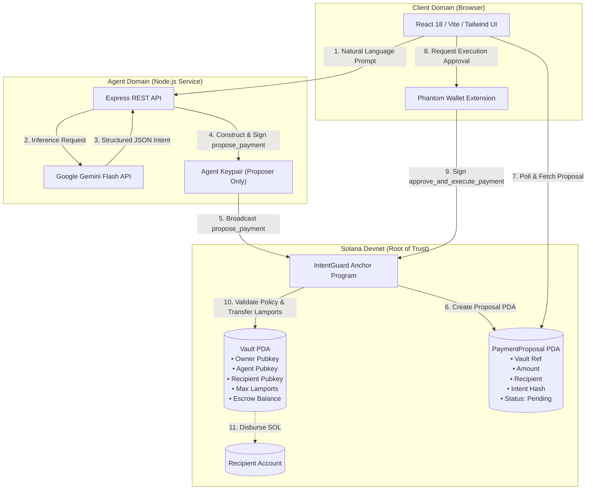
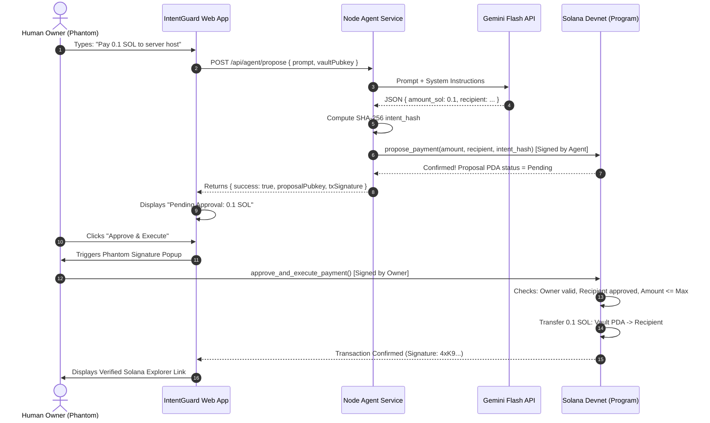
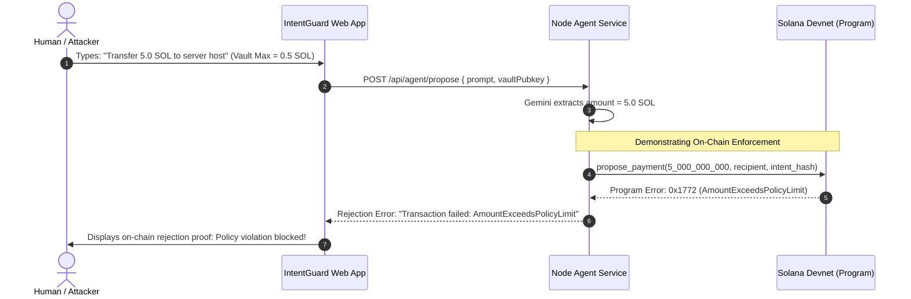

# ARCHITECTURE.md — IntentGuard Technical Architecture

**System:** IntentGuard  
**Tagline:** Human control for autonomous money.  
**Network:** Solana Devnet  
**Smart Contract Framework:** Anchor 1.1.2 (Rust)  

---

## 1. System Overview & Component Diagram

IntentGuard is partitioned into three discrete trust domains:
1. **The Client Domain (Untrusted/Owner Realm):** React frontend and Phantom wallet.
2. **The Autonomous Agent Domain (Semi-Trusted Realm):** Node.js backend executing Gemini Flash inference and signing proposals using a restricted agent keypair.
3. **The On-Chain Domain (Root of Trust):** Solana Devnet executing the Anchor smart contract.



---

## 2. Component Responsibilities

| Component | Technology | Responsibility | Security Boundary |
| :--- | :--- | :--- | :--- |
| **Frontend UI** | React 18, Vite, Tailwind | Renders dashboard, visualizes vault state, handles prompt input, surfaces pending proposals, and coordinates wallet signing. | Runs locally in browser; cannot bypass wallet approval or forge signatures. |
| **Phantom Wallet** | Web3 Browser Extension | Holds owner private key; signs transactions (`initialize_vault`, `deposit_sol`, `approve_and_execute_payment`). | Non-custodial; signs only after user explicitly reviews simulation. |
| **Backend Agent** | Node.js, TypeScript, Express | Accepts natural language prompts, coordinates with Gemini Flash, validates intent structure, and signs `propose_payment`. | Holds agent keypair; can ONLY propose, never release funds. |
| **Gemini Flash AI** | Google Gemini Flash API | Converts fuzzy natural language into typed, deterministic JSON parameters (`amount`, `recipient`, `reasoning`). | Isolated to backend; zero access to keys or wallet state. |
| **Solana Program** | Rust, Anchor | Manages Vault PDA and Proposal PDA; cryptographically enforces limits, whitelists, and signer authorizations. | The source of truth on Devnet. The deployer keeps upgrade authority unless it is revoked. |

---

## 3. Solana Program Design (Anchor)

### 3.1 Account State Structures

#### 1. `Vault` (Account PDA)
- **Seeds:** `[b"vault", owner.key().as_ref()]`
- **Purpose:** Acts as both the escrow holder of SOL and the immutable configuration storage.
```rust
#[account]
pub struct Vault {
    pub owner: Pubkey,               // 32 bytes: Human owner who controls the vault
    pub authorized_agent: Pubkey,    // 32 bytes: Authorized agent permitted to propose
    pub approved_recipient: Pubkey,  // 32 bytes: Whitelisted destination address
    pub max_amount_lamports: u64,    // 8 bytes:  Spending ceiling per proposal
    pub bump: u8,                    // 1 byte:   PDA bump seed
}

// Space is computed with #[derive(InitSpace)]: 8 + 105 = 113 bytes.
```

#### 2. `PaymentProposal` (Account PDA)
- **Seeds:** `[b"proposal", vault.key().as_ref()]`
- **Purpose:** Stores an active payment proposal awaiting owner approval.
```rust
#[derive(AnchorSerialize, AnchorDeserialize, Clone, Copy, PartialEq, Eq)]
pub enum ProposalStatus {
    Pending,
    Executed,
    Rejected,
}

#[account]
pub struct PaymentProposal {
    pub vault: Pubkey,               // 32 bytes: Parent vault reference
    pub agent: Pubkey,               // 32 bytes: Proposer agent public key
    pub recipient: Pubkey,           // 32 bytes: Intended destination
    pub amount: u64,                 // 8 bytes:  Proposed transfer amount (lamports)
    pub intent_hash: [u8; 32],       // 32 bytes: SHA-256 hash of AI prompt + intent
    pub status: ProposalStatus,      // 1 byte:   Proposal lifecycle status
    pub created_at: i64,             // 8 bytes:  Clock timestamp
    pub bump: u8,                    // 1 byte:   PDA bump seed
    pub nonce: u64,                  // 8 bytes:  Increases with every new proposal
}
```

---

### 3.2 Program Instructions & Access Control

#### Instruction 1: `initialize_vault`
- **Signer:** `owner` (Human owner)
- **Parameters:** `authorized_agent: Pubkey`, `approved_recipient: Pubkey`, `max_amount_lamports: u64`
- **Accounts:**
  - `[signer]` `owner: Signer<'info>`
  - `[mut]` `vault: Account<'info, Vault>` (PDA: `[b"vault", owner.key()]`)
  - `system_program: Program<'info, System>`
- **Logic:** Initializes the Vault PDA with the given policy rules.

#### Instruction 1b: `deposit_sol`
- **Signer:** `owner` (Human owner)
- **Parameters:** `amount: u64`
- **Logic:** Transfers SOL from the owner to the Vault PDA through the System Program.

#### Instruction 2: `update_policy`
- **Signer:** `owner` (Human owner)
- **Parameters:** `new_authorized_agent: Option<Pubkey>`, `new_approved_recipient: Option<Pubkey>`, `new_max_amount: Option<u64>`
- **Accounts:**
  - `[signer]` `owner: Signer<'info>`
  - `[mut, has_one = owner @ IntentGuardError::UnauthorizedOwner]` `vault: Account<'info, Vault>`
- **Logic:** Updates the authorized agent, approved recipient, or spending ceiling.

#### Instruction 3: `propose_payment`
- **Signer:** `agent` (Backend agent keypair)
- **Parameters:** `amount: u64`, `recipient: Pubkey`, `intent_hash: [u8; 32]`
- **Accounts:**
  - `[signer]` `agent: Signer<'info>`
  - `vault: Account<'info, Vault>`
  - `[mut]` `proposal: Account<'info, PaymentProposal>` (PDA: `[b"proposal", vault.key()]`)
  - `system_program: Program<'info, System>`
- **On-Chain Policy Invariants Checked:**
  1. `agent.key() == vault.authorized_agent` (Reject if unauthorized proposer).
  2. `recipient == vault.approved_recipient` (Reject if recipient is not whitelisted).
  3. `amount <= vault.max_amount_lamports` (Reject if amount exceeds ceiling).
  4. `amount <= vault.to_account_info().lamports() - Rent::get()?.minimum_balance(Vault::LEN)` (Reject if vault cannot remain solvent).
  5. The existing proposal is not `Pending` (Reject with `PendingProposalExists`). The agent can never swap a proposal the owner may be reviewing.
- **Logic:** Initializes the `proposal` account or reuses a resolved one, sets `ProposalStatus::Pending`, and increments `nonce`.

#### Instruction 4: `approve_and_execute_payment`
- **Signer:** `owner` (Human owner via Phantom)
- **Parameters:** `expected_nonce: u64` (the proposal the owner reviewed)
- **Accounts:**
  - `[signer]` `owner: Signer<'info>`
  - `[mut, has_one = owner @ IntentGuardError::UnauthorizedOwner]` `vault: Account<'info, Vault>`
  - `[mut, constraint = proposal.vault == vault.key() @ IntentGuardError::InvalidProposalVault]` `proposal: Account<'info, PaymentProposal>`
  - `[mut, constraint = recipient.key() == proposal.recipient @ IntentGuardError::InvalidRecipientAccount]` `recipient: AccountInfo<'info>`
  - `system_program: Program<'info, System>`
- **On-Chain Policy Invariants Checked:**
  1. `owner.key() == vault.owner`
  2. `proposal.status == ProposalStatus::Pending` (Reject if already executed or rejected).
  3. `proposal.recipient == vault.approved_recipient` (Re-verify policy consistency).
  4. `proposal.amount <= vault.max_amount_lamports` (Re-verify policy consistency).
  5. `proposal.agent == vault.authorized_agent` (Reject with `UnauthorizedAgent`, so a replaced agent's queued proposal can't be executed).
  6. `proposal.nonce == expected_nonce` (Reject with `StaleProposal`, so an old approval can't apply to a newer proposal).
  7. The vault stays rent-exempt after the transfer (Reject with `InsufficientVaultBalance`).
- **Execution Logic:**
  - Transfers `proposal.amount` lamports from `vault` PDA to `recipient` using PDA balance mutation:
    ```rust
    **vault.to_account_info().try_borrow_mut_lamports()? -= proposal.amount;
    **recipient.try_borrow_mut_lamports()? += proposal.amount;
    ```
  - Updates `proposal.status = ProposalStatus::Executed`.

#### Instruction 5: `reject_payment`
- **Signer:** `owner` (Human owner via Phantom)
- **Accounts:**
  - `[signer]` `owner: Signer<'info>`
  - `vault: Account<'info, Vault>`
  - `[mut]` `proposal: Account<'info, PaymentProposal>`
- **Logic:** Sets `proposal.status = ProposalStatus::Rejected`.

---

### 3.3 Custom Error Definitions

```rust
#[error_code]
pub enum IntentGuardError {
    #[msg("The signer is not authorized to propose payments for this vault.")]
    UnauthorizedAgent,

    #[msg("Only the registered vault owner can perform this operation.")]
    UnauthorizedOwner,

    #[msg("The proposed payment amount exceeds the maximum configured policy limit.")]
    AmountExceedsPolicyLimit,

    #[msg("The requested recipient does not match the approved recipient address.")]
    UnapprovedRecipient,

    #[msg("The payment proposal is not in a pending state.")]
    ProposalNotPending,

    #[msg("The vault has insufficient liquid lamports to execute this payment.")]
    InsufficientVaultBalance,

    #[msg("Proposal does not belong to the specified vault.")]
    InvalidProposalVault,

    #[msg("The passed recipient account does not match the proposal recipient.")]
    InvalidRecipientAccount,

    #[msg("The amount must be greater than zero.")]
    InvalidAmount,

    #[msg("The proposal changed since the owner reviewed it.")]
    StaleProposal,

    #[msg("A pending proposal already exists; the owner must approve or reject it first.")]
    PendingProposalExists,

    #[msg("Arithmetic overflow.")]
    ArithmeticOverflow,
}
```

---

## 4. AI Integration & Intent Pipeline

### 4.1 Natural Language Processing
The user submits a natural language sentence, such as:
> *"Disburse 0.15 SOL to our approved server provider for compute costs"*

The backend Node.js service passes this prompt to the Gemini Flash model with strict temperature (0.0) and a structured schema:

```json
{
  "is_payment_request": true,
  "amount": "0.15",
  "currency": "SOL",
  "recipient_type": "approved_recipient",
  "recipient_address": null,
  "memo": "compute costs for server host",
  "confidence": 0.98
}
```

The amount is a decimal string, converted to lamports exactly. For `approved_recipient`, the address is read from the vault's on-chain policy, never from the AI. For `explicit_address`, the address must appear literally in the prompt.

**Where checks happen:**
- **Off-chain (backend):** malformed output, non-payments, ambiguous requests, non-SOL currencies. These never reach Solana.
- **On-chain (program):** spending limit, recipient allowlist, agent authorization, proposal state. The backend deliberately does not pre-filter limit or recipient violations. It submits them with `skipPreflight`, so the program rejects them in a real failed Devnet transaction.

If Gemini is unavailable, the request fails with an error. There is no fallback parser.

### 4.2 Intent Hashing for Tamper Protection
To ensure off-chain parameters are not swapped or modified between agent inference and on-chain proposal:
```typescript
const rawPayload = JSON.stringify({
  prompt: userPrompt,
  amount_sol: parsed.amount_sol,
  recipient: parsed.recipient,
  timestamp: Date.now()
});
const intentHash = crypto.createHash('sha256').update(rawPayload).digest();
```
This 32-byte `intent_hash` is recorded directly inside the `PaymentProposal` PDA on Solana Devnet, binding the AI prompt to the on-chain proposal.

---

## 5. End-to-End Transaction Lifecycles

### 5.1 Success Lifecycle (Proposal -> Approval -> Transfer)



### 5.2 Rejection Lifecycle (Over-Limit Violation)



---

## 6. Frontend / Backend API Contract

### Endpoint: `POST /api/agent/parse-and-propose`
- **Request Body:**
  ```json
  {
    "prompt": "Pay 0.1 SOL to approved vendor for hosting",
    "vaultPubkey": "H97B5b...XYZ"
  }
  ```
- **Response (200 OK):**
  ```json
  {
    "status": "PROPOSED",
    "txSignature": "3q8H7bV4mN2...",
    "proposalPubkey": "7XzW9...",
    "parsedIntent": {
      "amountLamports": 100000000,
      "amountSol": 0.1,
      "recipient": "9WzDXwBbmkg8ZTbNMqUxvQRAyrZzDsGYdLVL9zYtAWWM",
      "reasoning": "hosting payment extracted from prompt"
    },
    "intentHash": "a1b2c3d4..."
  }
  ```
- **Response (200 OK, rejected on-chain):** The API call succeeded and the program refused the payment.
  ```json
  {
    "status": "REJECTED_BY_POLICY",
    "enforcedBy": "on-chain",
    "error": "AmountExceedsPolicyLimit",
    "errorCode": "0x1772",
    "message": "The proposed payment amount exceeds the maximum configured policy limit.",
    "txSignature": "<real failed Devnet transaction>",
    "explorerUrl": "https://explorer.solana.com/tx/<signature>?cluster=devnet"
  }
  ```

### Endpoint: `GET /api/agent/status`
- **Response:**
  ```json
  {
    "online": true,
    "agentPublicKey": "Agnt9Z3qF...",
    "geminiModel": "gemini-3.5-flash",
    "cluster": "devnet"
  }
  ```

