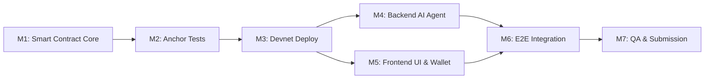

# BUILD_PLAN.md — IntentGuard Milestone Implementation Plan

**Project:** IntentGuard  
**Tagline:** Human control for autonomous money.  
**Execution Methodology:** Contract-First, Test-Driven, Verifiable Milestones  

---

## Overview

To guarantee delivery of a reliable, fully working vertical slice during the **MLH Solana Hackathon (November 6–8, 2026)**, implementation follows a strict 7-milestone sequence. Each milestone has crisp deliverables and non-negotiable exit criteria before moving to the next.

---

## Milestone 1: Smart Contract Core (Rust / Anchor)

### Objective
Implement the Anchor program on Solana that acts as the cryptographic root of trust for vault custody and payment policy enforcement.

### Tasks
- [ ] Initialize Anchor workspace: `programs/intentguard/`.
- [ ] Implement account data structures:
  - `Vault`: `owner`, `authorized_agent`, `approved_recipient`, `max_amount_lamports`, `bump`.
  - `PaymentProposal`: `vault`, `agent`, `recipient`, `amount`, `intent_hash`, `status`, `created_at`, `bump`.
- [ ] Implement instructions:
  - `initialize_vault`: Creates Vault PDA, records owner and initial policies.
  - `update_policy`: Permits owner to update agent, recipient, or max limit.
  - `propose_payment`: Allows authorized agent to record a pending payment proposal within policy constraints.
  - `approve_and_execute_payment`: Allows owner to verify and disburse SOL from Vault PDA directly to the recipient.
  - `reject_payment`: Allows owner to mark a proposal as rejected.
- [ ] Implement custom error enum (`IntentGuardError`).

### Deliverables
- `programs/intentguard/src/lib.rs`
- `programs/intentguard/src/state.rs`
- `programs/intentguard/src/errors.rs`
- Successful compilation with `anchor build`.

### Exit Criteria
- `anchor build` compiles cleanly without warnings or errors.

---

## Milestone 2: Anchor Integration Tests

### Objective
Validate every on-chain invariant using automated integration tests running on a local Solana validator.

### Tasks
- [ ] Set up test scaffolding in `tests/intentguard.ts` using `@coral-xyz/anchor`.
- [ ] Test **Happy Path:**
  - Owner initializes vault.
  - Owner deposits 1.0 SOL into vault.
  - Agent proposes 0.2 SOL payment to approved recipient.
  - Owner approves and executes payment.
  - Verify recipient balance increases by 0.2 SOL and vault balance decreases.
  - Verify proposal status changes to `Executed`.
- [ ] Test **Negative Scenarios (Policy Violations):**
  - Unauthorized party attempts to propose -> Reverts with `UnauthorizedAgent`.
  - Agent attempts to propose amount exceeding `max_amount_lamports` -> Reverts with `AmountExceedsPolicyLimit`.
  - Agent attempts to propose payment to an unapproved address -> Reverts with `UnapprovedRecipient`.
  - Non-owner attempts to execute payment -> Reverts with `UnauthorizedOwner`.
  - Owner attempts to execute an already executed proposal -> Reverts with `ProposalNotPending`.
  - Attempting to withdraw more than liquid vault balance -> Reverts with `InsufficientVaultBalance`.

### Deliverables
- `tests/intentguard.ts` containing at least 7 comprehensive test cases.

### Exit Criteria
- `anchor test` passes 100% with all negative error codes asserted.

---

## Milestone 3: Solana Devnet Deployment

### Objective
Deploy the validated Anchor smart contract to Solana Devnet and capture real on-chain identifiers.

### Tasks
- [ ] Generate or configure deployer keypair.
- [ ] Fund deployer account via Solana Devnet faucet (`solana airdrop 2 ...`).
- [ ] Synchronize program ID in `Anchor.toml` and `declare_id!(...)` in `lib.rs`.
- [ ] Run `anchor build && anchor deploy --provider.cluster devnet`.
- [ ] Export generated IDL (`target/idl/intentguard.json`) and TypeScript types (`target/types/intentguard.ts`).
- [ ] Record deployed Program ID in `PROJECT_STATE.md`.

### Deliverables
- Verified Devnet Program ID.
- IDL files exported to `frontend/src/idl/` and `backend/src/idl/`.

### Exit Criteria
- Program account confirmed live on Solana Devnet via `solana program show <PROGRAM_ID> --url devnet`.

---

## Milestone 4: Backend AI Agent Service

### Objective
Build a lightweight Node.js TypeScript service that hosts the authorized agent keypair and transforms natural language prompts into on-chain `propose_payment` transactions using Gemini Flash.

### Tasks
- [ ] Initialize Node.js Express project in `backend/`.
- [ ] Configure `backend/.env` with `GEMINI_API_KEY`, `AGENT_KEYPAIR_PATH`, `RPC_URL` (Devnet). The program ID comes from the IDL.
- [ ] Implement Gemini Flash prompt wrapper:
  - Enforce structured JSON output (`amount_sol`, `recipient`, `memo`).
  - Set model temperature to 0.0 for deterministic output.
- [ ] Implement off-chain policy pre-check and SHA-256 `intent_hash` generation.
- [ ] Implement Solana transaction builder:
  - Construct Anchor `propose_payment` instruction.
  - Sign with backend agent keypair.
  - Broadcast transaction to Solana Devnet and wait for confirmation.
- [ ] Expose REST endpoints:
  - `POST /api/agent/parse-and-propose`
  - `GET /api/agent/status`

### Deliverables
- `backend/src/server.ts`
- `backend/src/gemini.ts`
- `backend/src/solana.ts`
- `backend/.env.example`

### Exit Criteria
- Successful curl/test request converts a sample prompt into a confirmed `propose_payment` transaction on Solana Devnet.

---

## Milestone 5: Frontend Dashboard & Phantom Integration

### Objective
Build an intuitive, responsive React web application that allows the human owner to configure their vault, interact with the AI agent, and execute payments via Phantom wallet.

### Tasks
- [ ] Initialize React + Vite + TypeScript application in `frontend/`.
- [ ] Configure Tailwind CSS with dark cyber-security theme.
- [ ] Integrate `@solana/wallet-adapter-react` and Phantom adapter.
- [ ] Build UI sections:
  1. **Header:** Title, tagline, network badge (Devnet), Phantom connect button.
  2. **Vault Management Card:** Display Vault PDA, SOL balance, and policy settings (`authorized_agent`, `approved_recipient`, `max_amount`).
  3. **Initialize / Deposit Modal:** Forms to initialize vault and deposit SOL.
  4. **Natural Language Console:** Chat/prompt box where user enters directives for the AI agent.
  5. **Pending Proposal Inspector:** Card displaying pending proposal details (amount, recipient, AI reasoning, intent hash) with **Approve & Execute** and **Reject** buttons.
  6. **Explorer Transaction Feed:** Displays real Devnet signatures with direct links to Solana Explorer.
- [ ] Implement execution signing:
  - Construct `approve_and_execute_payment` transaction.
  - Send to Phantom for owner signature.
  - Confirm on Devnet and update UI balance.

### Deliverables
- Complete frontend codebase in `frontend/`.
- Clean responsive UI running on `http://localhost:5173`.

### Exit Criteria
- Owner can connect Phantom, view vault balance, and execute transactions directly through the browser.

---

## Milestone 6: End-to-End Integration & Devnet Verification

### Objective
Connect frontend, backend, AI, and Solana Devnet into a seamless, unified demonstration.

### Tasks
- [ ] Verify full happy-path flow:
  1. Owner creates vault with limit (e.g. 0.5 SOL).
  2. Owner deposits 1.0 SOL.
  3. User enters prompt: *"Pay 0.2 SOL to server host"*.
  4. Agent parses prompt and submits proposal to Devnet.
  5. UI displays pending proposal card.
  6. Owner approves with Phantom.
  7. 0.2 SOL transferred to recipient on Devnet.
  8. Explorer link rendered and verified.
- [ ] Verify full negative-path flow:
  1. User enters prompt: *"Pay 2.0 SOL to server host"* (exceeds 0.5 SOL limit).
  2. Program rejects proposal on-chain (`AmountExceedsPolicyLimit`).
  3. UI displays clear error toast explaining policy violation.

### Deliverables
- End-to-end operational system verified on Devnet.
- Screen captures of successful transaction and blocked policy attempt.

### Exit Criteria
- Zero errors in browser console during full execution.
- Actual transaction signature confirmed on `https://explorer.solana.com/?cluster=devnet`.

---

## Milestone 7: QA & Hackathon Submission

### Objective
Finalize submission materials, record demo video, and publish clean open-source repository.

### Tasks
- [ ] Perform security audit against `docs/SECURITY.md`.
- [ ] Verify `.gitignore` prevents staging of any `.env` or keypair file.
- [ ] Record 3-minute demo video following `docs/SUBMISSION.md` script.
- [ ] Prepare Devpost submission text with architecture diagrams and Devnet links.
- [ ] Tag git release `v1.0.0-hackathon`.

### Exit Criteria
- Complete Devpost submission submitted before hackathon deadline.

