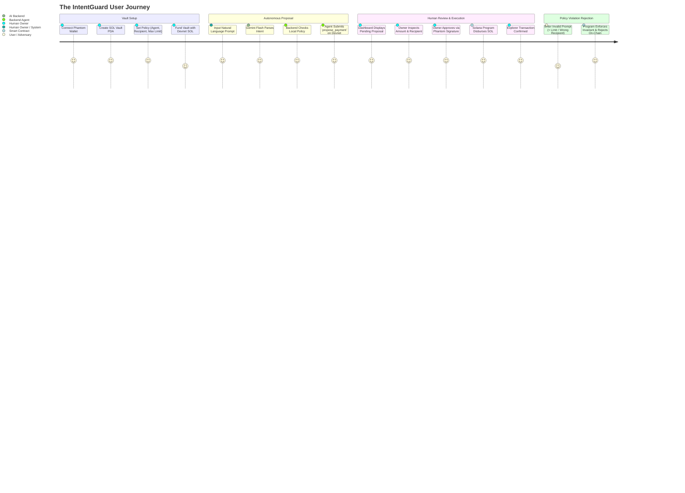

# PRODUCT.md — IntentGuard Product Specification

**Project Name:** IntentGuard  
**Tagline:** Human control for autonomous money.  
**Hackathon:** MLH Solana Hackathon (November 6–8, 2026)  
**Target Platform:** Solana Devnet, Phantom Wallet, Modern Web  

---

## 1. Problem Statement

Autonomous AI agents are shifting from passive text generators to active actors in the digital economy. They can browse the web, write code, interact with APIs, and increasingly need to make financial disbursements (e.g., paying for RPC node compute, purchasing training datasets, booking domain names, or rewarding contractors).

However, integrating AI agents with financial rails currently presents a critical security paradox:

1. **The Full-Custody Hazard:** Giving an AI agent direct access to a private key or unrestricted wallet means any prompt injection, model hallucination, or compromised backend host can immediately drain the wallet balance to zero.
2. **The Off-Chain Illusion:** Implementing spending limits solely on a Node.js backend or database server is fundamentally fragile. A server-side bug, an administrative compromise, or an internal API bypass completely defeats the safeguard.
3. **The Manual Bottleneck:** Forcing human developers to manually craft every blockchain transaction destroys the autonomy and utility of the agent.

### The Solution: IntentGuard
IntentGuard introduces an on-chain **Intent & Policy Firewall**. The AI agent is given an authorized identity, but is restricted by a Solana smart contract to only **propose** payments that conform to strict policy limits. The human owner retains non-custodial authorization via their Phantom wallet. Funds are held in a Program Derived Address (PDA) vault and can only be disbursed if the smart contract mathematically verifies both the policy compliance and the owner's signature.

---

## 2. Target Users & Personas

### Persona A: The AI Agent Developer ("Alex")
- **Profile:** Software engineer building autonomous agent swarms that run on background servers and perform automated infrastructure provisioning.
- **Pain Point:** Wants agents to pay for API usage and compute credits automatically, but is terrified of storing a hot wallet private key in a server `.env` file where a hallucinating prompt could send 50 SOL to an attacker.
- **IntentGuard Benefit:** Alex deposits 1 SOL into an IntentGuard vault, whitelists the compute vendor's public key, sets a 0.25 SOL cap, and gives the agent proposing rights. Even if the agent goes rogue, it cannot touch unapproved addresses or exceed the limit.

### Persona B: The DAO / Treasury Operator ("Maya")
- **Profile:** Treasury manager delegating micro-payments and recurring bounties to AI coordination bots.
- **Pain Point:** Multi-sig setups are too slow and bulky for micro-payments, while single-sig bot wallets create liability.
- **IntentGuard Benefit:** Provides a streamlined human-in-the-loop workflow where the AI prepares everything, validates intent, and surfaces one-click Phantom approval requests with full cryptographic auditability.

---

## 3. Product Goals

1. **Demonstrate Uncompromising On-Chain Security:** Spending rules must be enforced by Anchor constraints on Solana, not just client-side validation.
2. **Deliver Frictionless Natural Language Interaction:** Allow humans to converse with or command the agent naturally (e.g., *"Pay 0.2 SOL to server host for monthly compute"*), transforming fuzzy human intent into strict on-chain byte payloads.
3. **Provide Complete Transparency:** Every action—from proposal initialization to owner execution—must produce genuine Solana Devnet transactions that can be inspected on Solana Explorer.
4. **Deliver a Tight, Production-Grade Vertical Slice:** Ship zero mock features; focus on a rock-solid single-agent, single-recipient policy engine.

---

## 4. User Journey

### Step-by-Step Flow:
1. **Wallet Connection:** The owner lands on the IntentGuard web application and connects their Phantom wallet on Solana Devnet.
2. **Vault Initialization:** The owner creates a dedicated `Vault` PDA tied to their public key.
3. **Policy Configuration:** In the UI, the owner defines:
   - **Authorized Agent:** The public key of the backend service agent.
   - **Approved Recipient:** The single whitelisted vendor/destination address.
   - **Max Transfer Limit:** The ceiling in SOL (e.g., 0.5 SOL).
4. **Vault Funding:** The owner deposits Devnet SOL into the Vault PDA.
5. **Agent Prompting:** The user enters a natural language directive into the agent console (e.g., *"Pay 0.1 SOL to our server host for cloud compute"*).
6. **Intent Parsing:** Google Gemini Flash extracts structured parameters (`amount: 0.1`, `recipient: <PUBKEY>`).
7. **Proposal Submission:** The authorized backend agent signs and broadcasts a `propose_payment` transaction on Solana Devnet. The smart contract validates that the agent is authorized and that the proposal respects the vault's limits.
8. **Human Approval:** The web dashboard detects the on-chain proposal. The human owner reviews the details and clicks **Approve & Execute**.
9. **Execution & Finality:** Phantom prompts the owner for their signature. The smart contract executes the transfer directly from the Vault PDA to the recipient. The UI displays the verified transaction signature with a direct link to Solana Explorer.
10. **Policy Rejection Test:** The user tests an invalid prompt (e.g., *"Pay 5.0 SOL to hacker address"*). The agent submits it anyway, and the Solana smart contract reverts the transaction with a custom error (`AmountExceedsPolicyLimit` or `UnapprovedRecipient`).

---

## 5. Core Features (Included in Scope)

### F1: Program-Controlled Vault PDA
- A cryptographically secure Solana PDA derived from seeds `[b"vault", owner.key()]`.
- Holds native SOL escrow without relying on external custodians.
- Can only be drained via valid program instructions signed by the authorized owner.

### F2: On-Chain Policy Engine
- Stores the policy rules:
  - `authorized_agent`: Exactly 1 authorized AI agent public key.
  - `approved_recipient`: Exactly 1 whitelisted destination public key.
  - `max_amount_lamports`: Maximum allowable payment per proposal.
- Can be updated only by the vault owner.

### F3: Natural Language Intent Engine
- Server-side integration with Google Gemini Flash.
- Converts unstructured user prompts into typed JSON schemas.
- Computes an SHA-256 intent hash stored on-chain for tamper-evident auditing.

### F4: On-Chain Proposal Management
- Ephemeral `PaymentProposal` PDA storing amount, recipient, status (`Pending`, `Executed`, `Rejected`), and timestamp.
- Atomic state transitions prevent double-spending or replay attacks.

### F5: Non-Custodial Phantom Approval
- Standard Solana Wallet Adapter integration.
- Human owner reviews transaction simulation and confirms execution directly in the Phantom extension.

### F6: Solana Explorer Real-Time Verification
- Displays actual transaction signatures and clickable Solana Explorer URLs (`https://explorer.solana.com/tx/.../?cluster=devnet`).
- Zero fabricated transactions.

---

## 6. Out-of-Scope Features (Explicit Restrictions)

To guarantee delivery of a reliable, fully working vertical slice during the hackathon, the following features are strictly deferred to future versions:

- **Multiple Agents:** Supporting teams of agents with different permission tiers.
- **Multiple Recipients / Dynamic Address Books:** Allowing multi-destination arrays or dynamic whitelist pagination.
- **SPL Token Support:** Support for USDC, USDT, or custom SPL tokens (strictly native SOL only).
- **Daily / Cumulative Sliding Budget Windows:** Tracking 24-hour rolling velocity limits.
- **Analytics Dashboards & Charting:** Complex historical spend analytics or graph visualizations.
- **External Relational / Document Databases:** Storing state in PostgreSQL, MongoDB, or Redis (state lives on-chain and in-memory).
- **Push / External Notifications:** Telegram bots, Discord webhooks, or email notifications.

